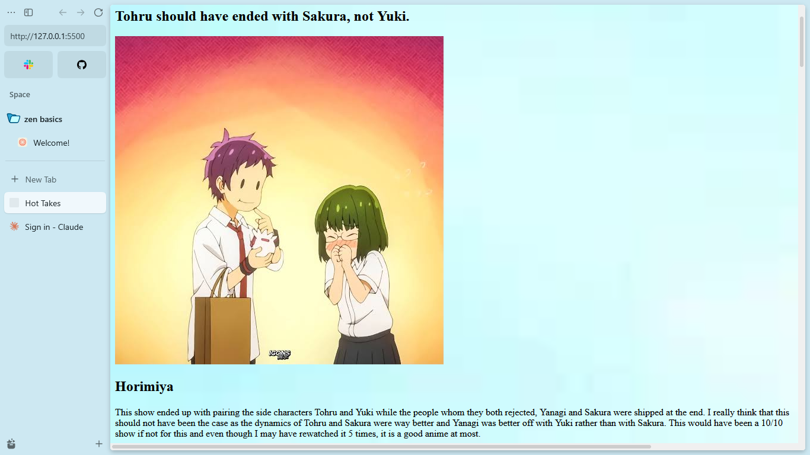
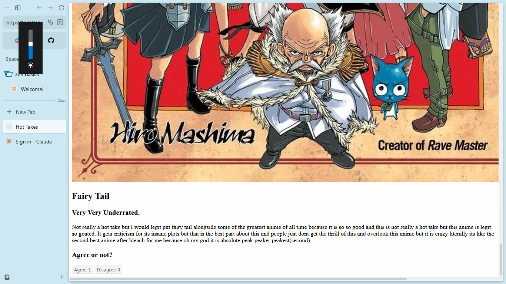

## My Anime Hot Takes

Demo: https://lwhsbg.github.io/anime-hot-takes/

## What It Is

It is a site I made which contins some of my rather controversial takes in anime with the anime name and a description of my explanation on why my take is justified or not.

## How to run it

It is not that complicated, just read my takes and press on the agree or disagree button, and yeah that is all. 

## Given Animes:

-Horimiya

-One Piece

-Sword Art Online

-Dragon Ball 

-Fairy Tail

## Why I made it

I made it because I wanted a site where I could put my hot takes in, and might even update this site with more of my takes and new features in the future.

## How I Made It

It is just simple HTML and Javascript(For the buttons) with a tiny bit of CSS.

## What I Struggled With and What I learnt

I did struggle with putting a special layout for the CSS but in the end I thought this website was more about my takes than the special layout so I just put a silly background image at the end of it all and It was a very fun project as I had to do research on the Internet about these shows too.

## Preview Images

